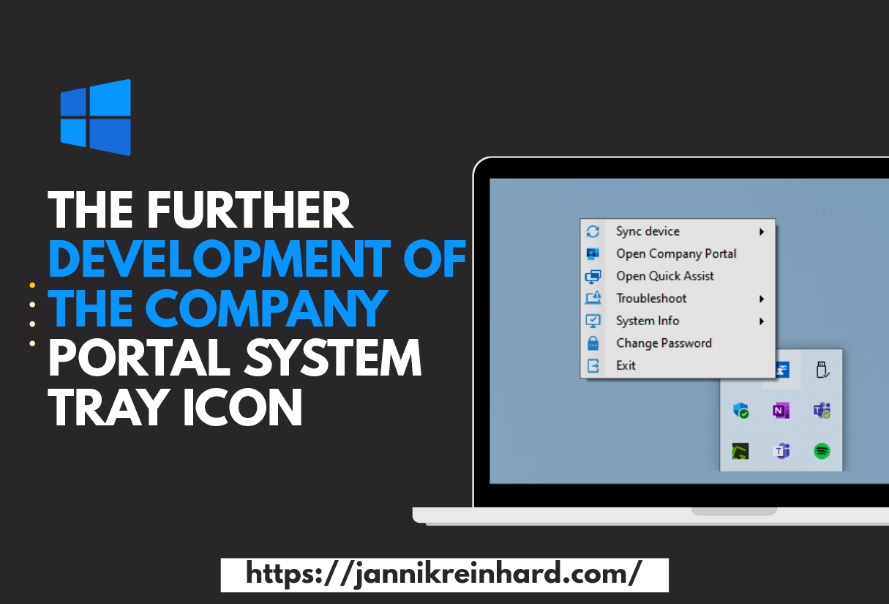

<!-- jr-brand:start -->
<p align="center">
  <a href="https://jannikreinhard.com/">
    
  </a>
</p>
<p align="center">
  <a href="https://jannikreinhard.com/">Website</a> ·
  <a href="https://www.linkedin.com/in/jannik-r/">LinkedIn</a> ·
  <a href="https://x.com/jannik_reinhard">X</a> ·
  <a href="https://www.youtube.com/@jannikreinhard">YouTube</a>
</p>
<!-- jr-brand:end -->

# Intune Company Portal tray

**Type:** Tool or application · **Status:** Community project

## Overview

System tray tool that extends Intune Company Portal with quick-access device management actions.

This Windows system tray tool gives users quick access to common Microsoft Intune and support actions without opening several portals or applications.



## Quickstart

Get the source locally:

```bash
git clone https://github.com/JayRHa/intune-company-portal-tray.git
cd intune-company-portal-tray
```

## Features

| Action | What It Does |
| --- | --- |
| Sync Device | Starts a device sync with Microsoft Intune |
| Company Portal | Opens the Company Portal |
| Quick Assist | Starts Microsoft's remote support tool |
| Troubleshoot | Opens the included troubleshooting workflow |
| System Info | Shows useful device information |
| Change Password | Opens the password change experience |

## Deployment

The repository includes a ready-to-upload `install.intunewin` package. You can also review or adapt the installation source in `sources/`.

Test the package with a limited Microsoft Intune assignment before deploying it to all users.

## License

This project is available under the terms in [LICENSE](LICENSE).

<!-- jr-brand-footer:start -->
---

[Articles and guides](https://jannikreinhard.com/) · [Repository index](https://github.com/JayRHa/.github/blob/main/REPOSITORIES.md)
<!-- jr-brand-footer:end -->
